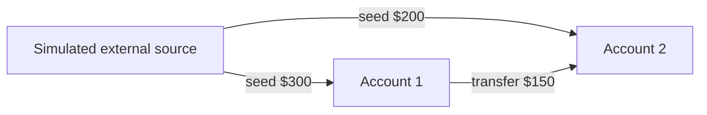
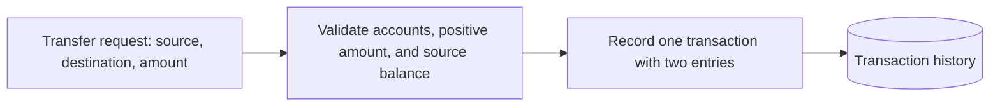
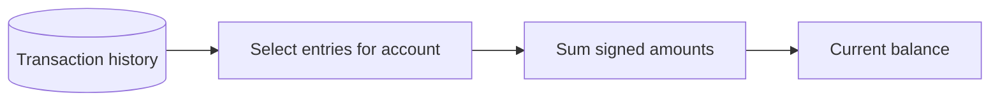

# LedgerLab — Accounts Stage

## Scope

LedgerLab currently models two accounts and a transaction history. Each account has an ID and optional display name. **Balances are calculated from transactions; they are never stored on accounts.** Features beyond creating accounts, simulated seed funding, transfers, and reading balances are out of scope.

## Account relationships



The external source is a bookkeeping offset for the initial $500. It represents simulated money entering LedgerLab, not another user account or a real payment integration.

## Transaction model and flow

Each transaction has an ID and two signed entries: a debit from the source and an equal credit to the destination. Entries are kept in history; a transaction is recorded only when the source has enough derived funds.



Seed funding uses the same entry pattern: debit the simulated external source and credit the chosen account. Each transaction's entries sum to zero.

## Balance derivation

For an account, `balance = sum(entry.amount)` across all entries in transaction history with that account ID. Positive entries add funds; negative entries remove funds.



## Example transfer

```mermaid
sequenceDiagram
    participant E as Simulated external source
    participant A1 as Account 1
    participant A2 as Account 2
    E->>A1: Seed $300
    E->>A2: Seed $200
    A1->>A2: Transfer $150
    Note over A1,A2: Derived balances: A1 $150; A2 $350
```

| Transaction | External source | Account 1 | Account 2 |
| --- | ---: | ---: | ---: |
| Seed Account 1 | −$300 | +$300 | — |
| Seed Account 2 | −$200 | — | +$200 |
| Transfer | — | −$150 | +$150 |
| **Derived balance** | **−$500** | **$150** | **$350** |